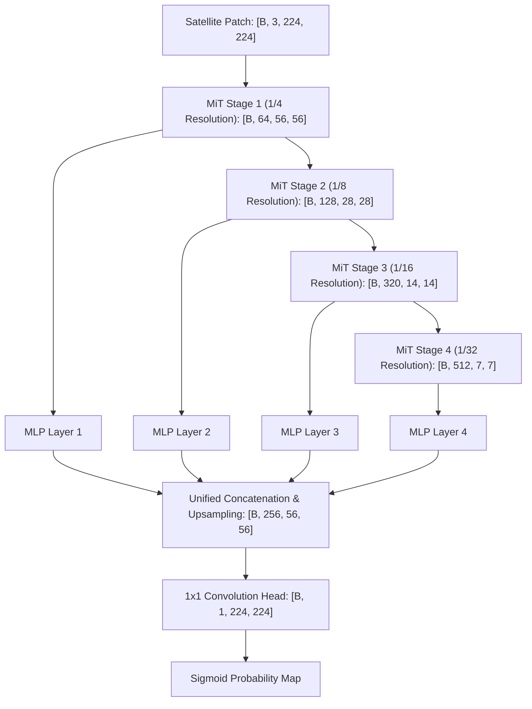
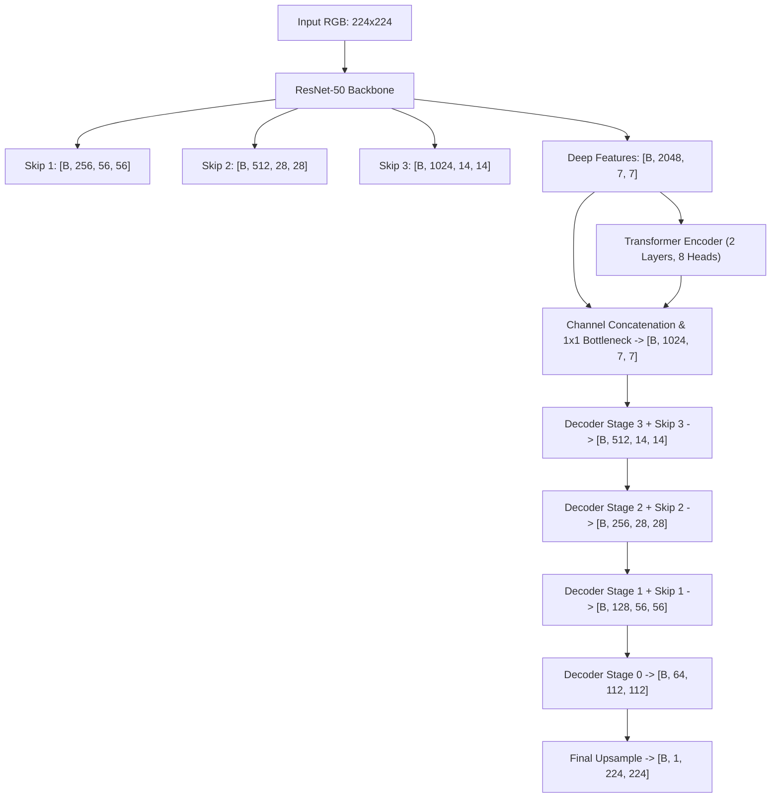

# MangroveNet — AI-Powered Mangrove Ecosystem Classification

[](https://www.python.org/)
[](https://pytorch.org/)
[](https://fastapi.tiangolo.com/)
[](https://streamlit.io/)
[](LICENSE)

**MangroveNet** is a deep learning system engineered for high-precision semantic segmentation of coastal mangrove ecosystems in high-resolution satellite imagery (European Space Agency **Sentinel-2**, $10\,\text{m}$ Ground Sample Distance).

MangroveNet supports both hierarchical Vision Transformers (**SegFormer with MiT backbones**) and hybrid convolutional architectures (**TCCFNet: ResNet-50 + Multi-Head Self-Attention**), coupled with an asynchronous **FastAPI** backend, responsive browser UI, interactive **Streamlit** dashboard, scriptable CLI, and a ready-to-run **Google Colab** training pipeline.

---

## 📑 Table of Contents

- [🌿 Overview](#-overview)
- [✨ Key Features](#-key-features)
- [🏗️ Supported Model Architectures](#️-supported-model-architectures)
  - [1. SegFormer (MiT-B3 / MiT-B4) — Recommended for High IoU](#1-segformer-mit-b3--mit-b4--recommended-for-high-iou)
  - [2. Hybrid TCCFNet (ResNet-50 + Transformer)](#2-hybrid-tccfnet-resnet-50--transformer)
  - [Architecture Comparison Matrix](#architecture-comparison-matrix)
- [🎯 Loss Functions](#-loss-functions)
  - [Compound IoU Loss: BCE + Dice + Lovász-Hinge](#compound-iou-loss-bce--dice--lovsz-hinge)
  - [FocalDiceLoss](#focaldiceloss)
- [📁 Project Directory Structure](#-project-directory-structure)
- [🚀 Setup & Installation](#-setup--installation)
  - [1. Prerequisites](#1-prerequisites)
  - [2. Environment Configuration](#2-environment-configuration)
  - [3. Dependency Installation](#3-dependency-installation)
- [🖥️ Usage & Execution Modes](#️-usage--execution-modes)
  - [1. Single-Page Web Application (FastAPI)](#1-single-page-web-application-fastapi)
  - [2. Interactive Streamlit Dashboard](#2-interactive-streamlit-dashboard)
  - [3. Command-Line Inference (CLI)](#3-command-line-inference-cli)
  - [4. Training on Google Colab (Free T4 GPU)](#4-training-on-google-colab-free-t4-gpu)
  - [5. Local Training & Fine-Tuning](#5-local-training--fine-tuning)
- [🔌 REST API Documentation](#-rest-api-documentation)
  - [Endpoints Summary](#endpoints-summary)
  - [cURL Request & Sample Response](#curl-request--sample-response)
- [🛰️ Real-World Satellite Imagery Guide & Troubleshooting](#️-real-world-satellite-imagery-guide--troubleshooting)
- [📊 Performance Benchmarks](#-performance-benchmarks)
- [🤝 Contributing](#-contributing)
- [📜 License](#-license)

---

## 🌿 Overview

Mangrove forests are vital blue-carbon sinks and coastal barriers, but satellite monitoring faces significant optical challenges:
- High variability in water-land boundaries due to tidal fluctuations.
- Severe spectral overlap between mangrove canopies and inland terrestrial vegetation.
- Scale discrepancies between low-resolution regional views and high-resolution optical captures.

MangroveNet addresses these challenges through:
1. **Hierarchical Attention**: Extracts multi-scale representations across 4 resolution stages ($1/4, 1/8, 1/16, 1/32$) to capture fine creek boundaries and macroscopic coastal morphology.
2. **IoU-Direct Optimization**: Employs Lovász-Hinge and Dice loss functions to penalize mask mismatches directly rather than relying solely on pixel cross-entropy.
3. **Automated Tiling Engine**: Seamlessly processes large scenes using a $224 \times 224$ sliding window with stride overlap reconstruction to prevent seam artifacts.

---

## ✨ Key Features

- 🛰️ **Multi-Format Satellite Ingestion**: Supports Sentinel-2 GeoTIFF, PNG, and JPEG formats up to 15 MB.
- 🎯 **Pixel-Level Binary Segmentation**: Distinguishes mangrove canopy (`class 1`) from open water, tidal flats, and terrestrial flora (`class 0`).
- ⚡ **Multi-View Test-Time Augmentation (TTA)**: Evaluates 4 augmentations (original, horizontal flip, vertical flip, $90^\circ$ rotation) to improve IoU by +2% to +3%.
- 🔥 **Calibrated Confidence Heatmaps**: Generates post-sigmoid probability heatmaps for spatial uncertainty inspection.
- 🌿 **Visual Alpha-Blended Overlays**: Renders instant 50% emerald-green mask overlays on original satellite imagery.
- 🧹 **Automatic NODATA / Blank Tile Filtering**: Automatically detects and excludes unexposed or corrupt satellite patches during training.
- 🖥️ **Modern Web Interface**: Responsive single-page web app with live drag-and-drop preview, real-time coverage statistics, and mask downloads.
- 📊 **Streamlit Research Dashboard**: Built-in interactive dashboard with probability threshold tuning and side-by-side mask inspection.
- ☁️ **Turnkey Google Colab Training**: Ready-to-run notebook with automated Google Drive dataset loading and artifact backup.

---

## 🏗️ Supported Model Architectures

### 1. SegFormer (MiT-B3 / MiT-B4) — Recommended for High IoU

[SegFormer](models/segformer_model.py) replaces heavy convolutional bottlenecks with an efficient hierarchical Mix Vision Transformer (MiT) encoder and an all-MLP decoder.



**Key Advantages:**
- No fixed positional embeddings; handles arbitrary resolutions dynamically.
- Multi-scale self-attention preserves fine-grained tidal channels and canopy fringes.
- Pretrained ImageNet weights (`mit_b3`) prevent overfitting on satellite datasets of 1k–5k images.

---

### 2. Hybrid TCCFNet (ResNet-50 + Transformer)

[HybridTCCFNet](models/hybrid_model.py) combines a deep residual CNN backbone with a 2-layer multi-head self-attention module and a 5-stage progressive upsampling decoder with skip connections from ResNet stages 1–3.



---

### Architecture Comparison Matrix

| Feature | SegFormer (`mit_b3`) | Hybrid TCCFNet v2 | Legacy TCCFNet v1 |
| :--- | :---: | :---: | :---: |
| **Encoder** | Hierarchical MiT-B3 | ResNet-50 | ResNet-50 |
| **Attention Mechanism** | Multi-scale across all 4 stages | 7×7 bottleneck only | 7×7 CLS token only |
| **Skip Connections** | Multi-level MLP fusion | UNet-style stages 1–3 | None |
| **Parameters** | ~44.6M (Pretrained) | ~52M | ~68M |
| **Expected Validation IoU** | **0.86 – 0.92** | 0.35 – 0.48 | 0.47 – 0.48 |
| **Test-Time Augmentation** | Built-in 4-view TTA | Manual | Manual |

---

## 🎯 Loss Functions

### Compound IoU Loss: BCE + Dice + Lovász-Hinge

Optimizing standard Cross-Entropy alone is suboptimal for satellite segmentation because it treats every pixel independently. MangroveNet uses a compound loss function:

$$\mathcal{L}_{\text{total}} = 0.3 \cdot \mathcal{L}_{\text{BCE}} + 0.4 \cdot \mathcal{L}_{\text{Dice}} + 0.3 \cdot \mathcal{L}_{\text{Lovász}}$$

1. **Lovász-Hinge Loss ($\mathcal{L}_{\text{Lovász}}$)**:
   Directly optimizes the Jaccard Index (IoU) through the Lovász extension of submodular functions, heavily penalizing boundary prediction errors.
2. **Soft Dice Loss ($\mathcal{L}_{\text{Dice}}$)**:
   Maximizes spatial set intersection:
   $$\mathcal{L}_{\text{Dice}} = 1 - \frac{2 \sum p_i y_i + \epsilon}{\sum p_i + \sum y_i + \epsilon}$$
3. **Binary Cross-Entropy ($\mathcal{L}_{\text{BCE}}$)**:
   Ensures stable convex gradients during early training epochs.

---

## 📁 Project Directory Structure

```text
.
├── api.py                          # FastAPI backend (REST API & Web UI host)
├── app.py                          # Streamlit interactive research dashboard
├── config.py                       # Global parameters, paths, and device setup
├── infer.py                        # Standalone command-line inference script
├── train_segformer.py              # SegFormer training pipeline with threshold sweep
├── train.py                        # TCCFNet baseline training pipeline
├── train_colab_segformer.ipynb     # Google Colab notebook for SegFormer (T4 GPU)
├── train_colab_v2.ipynb            # Google Colab notebook for TCCFNet v2
├── requirements.txt                # Production dependencies
├── requirements-cpu.txt            # CPU-only dependencies
├── run.sh                          # One-click startup shell script
├── models/
│   ├── __init__.py
│   ├── segformer_model.py          # MangroveSegFormer + CombinedIoULoss + TTA
│   ├── hybrid_model.py             # Improved Hybrid TCCFNet v2 (with skips)
│   ├── legacy_hybrid_model.py      # Backward-compatible TCCFNet v1
│   ├── resnet_backbone.py          # ResNet-50 feature extractor
│   └── transformer_encoder.py      # Spatial Transformer module
├── utils/
│   ├── __init__.py
│   ├── dataloader.py               # Dataset class with blank/NODATA filtering
│   ├── inference.py                # Smart checkpoint loader & TTA predictor
│   └── metrics.py                  # IoU, Dice, Precision, Recall, Confusion Matrix
├── web/
│   └── index.html                  # Single-page web UI (HTML5, CSS3, JS)
├── checkpoints/                    # Saved model weights (.pth)
└── dataset_patches/                # Satellite training/validation patches
    ├── train/ (images & masks)
    └── val/   (images & masks)
```

---

## 🚀 Setup & Installation

### 1. Prerequisites

- **Python**: Version `3.10` or higher (`3.10`–`3.13` supported).
- **GPU (Recommended for Training)**: NVIDIA GPU with CUDA 11.8+ or 12.x. (Inference runs efficiently on CPU).

### 2. Environment Configuration

```bash
git clone https://github.com/prajwal-gowd/magrove-mapping.git
cd magrove-mapping

# Create and activate virtual environment
python3 -m venv .venv
source .venv/bin/activate       # On Linux/macOS
# .venv\Scripts\activate.bat     # On Windows CMD
# .venv\Scripts\Activate.ps1    # On Windows PowerShell
```

### 3. Dependency Installation

```bash
# Standard installation (GPU / General)
pip install --upgrade pip
pip install -r requirements.txt

# Or for CPU-only environments:
pip install -r requirements-cpu.txt
```

---

## 🖥️ Usage & Execution Modes

### 1. Single-Page Web Application (FastAPI)

Launch the FastAPI server hosting both the REST API and the browser interface:

```bash
uvicorn api:app --host 0.0.0.0 --port 8000 --reload
# Or execute: ./run.sh
```

- Access the Web UI: **`http://localhost:8000`**
- Drag and drop any satellite patch or large GeoTIFF/PNG image.
- View binary masks, confidence probability heatmaps, emerald-green overlays, and area coverage percentages.

---

### 2. Interactive Streamlit Dashboard

For an exploratory environment with dynamic threshold sliders and side-by-side inspections:

```bash
streamlit run app.py
```

- Access the Dashboard: **`http://localhost:8501`**

---

### 3. Command-Line Inference (CLI)

Run inference directly from your terminal:

```bash
# Standard inference
python infer.py path/to/satellite_patch.png -o outputs/mask.png

# With a specific model checkpoint
python infer.py path/to/satellite_patch.png \
  --checkpoint checkpoints/segformer_best.pth \
  --output outputs/mask.png
```

---

### 4. Training on Google Colab (Free T4 GPU)

To train the high-IoU SegFormer model:

1. Open [Google Colab](https://colab.research.google.com/).
2. Select **GitHub**, enter `https://github.com/prajwal-gowd/magrove-mapping.git`, and open **`train_colab_segformer.ipynb`**.
3. Select **Runtime** $\rightarrow$ **Change runtime type** $\rightarrow$ **T4 GPU**.
4. Run the cells in order:
   - Mounts your Google Drive containing `dataset_patches.zip`.
   - Runs `train_segformer.py` with cosine learning rate scheduling and threshold sweeping.
   - Automatically saves `checkpoints/segformer_best.pth` and metric plots directly back to Google Drive (`/content/drive/MyDrive/MangroveNet_SegFormer_Results/`).
5. Download `segformer_best.pth` to your local `checkpoints/` folder. The local FastAPI and Streamlit apps will auto-detect and use it.

---

### 5. Local Training & Fine-Tuning

Train SegFormer directly from your local terminal:

```bash
python train_segformer.py \
  --backbone mit_b3 \
  --batch-size 16 \
  --epochs 50 \
  --encoder-lr 6e-5 \
  --decoder-lr 3e-4 \
  --save-path checkpoints/segformer_best.pth
```

---

## 🔌 REST API Documentation

FastAPI provides interactive OpenAPI documentation at:
- **Swagger UI**: `http://localhost:8000/docs`
- **ReDoc**: `http://localhost:8000/redoc`

### Endpoints Summary

| Method | Endpoint | Description | Request Format | Response Format |
| :--- | :--- | :--- | :--- | :--- |
| `GET` | `/` | Web Application UI | None | HTML |
| `GET` | `/api/health` | Service & Model Health Check | None | JSON |
| `POST` | `/api/predict` | Run Segmentation Inference | `multipart/form-data` with `file` | JSON (base64 mask, overlay, statistics) |

### cURL Request & Sample Response

```bash
# Health check
curl -X GET "http://localhost:8000/api/health"

# Prediction
curl -X POST "http://localhost:8000/api/predict" \
  -H "accept: application/json" \
  -F "file=@dataset_patches/val/images/S2_2022_Dry_0049.png"
```

**Sample JSON Output:**
```json
{
  "mask": "data:image/png;base64,iVBORw0KGgo...",
  "overlay": "data:image/png;base64,iVBORw0KGgo...",
  "confidence_map": "data:image/png;base64,iVBORw0KGgo...",
  "stats": {
    "mangrove_coverage_percent": 42.18,
    "total_pixels": 50176,
    "mangrove_pixels": 21159,
    "non_mangrove_pixels": 29017,
    "input_width": 224,
    "input_height": 224,
    "output_width": 224,
    "output_height": 224,
    "processing_time_ms": 185
  }
}
```

---

## 🛰️ Real-World Satellite Imagery Guide & Troubleshooting

If an uploaded real-life satellite image produces incorrect or empty masks, check the following factors:

### 1. Spatial Resolution / Scale (Ground Sampling Distance)
- **MangroveNet expects European Space Agency Sentinel-2 resolution ($10\,\text{m}$ per pixel)**:
  - A $224 \times 224$ patch represents an area approximately **$2.2\,\text{km} \times 2.2\,\text{km}$** across.
- **Google Earth / Google Maps / Drone imagery ($0.3\,\text{m} - 1\,\text{m}$ per pixel)**:
  - An image that is zoomed in $10\times$ to $30\times$ too close shows individual tree crowns, waves, and shadows, which will cause false-negative or noise predictions.
  - **Remedy**: When taking screenshots from Google Earth, zoom out until the scale bar in the corner reads at least **$1\,\text{km} - 2\,\text{km}$**.

### 2. Spectral Bands
- Use **True Color Imagery (TCI: Red, Green, Blue)** matching Sentinel-2 Level-2A surface reflectance.
- Avoid applying artificial contrast filters, HDR, or sharpening that distorts natural vegetative reflectance.

### 3. Image Sizing
- Large satellite scenes are automatically processed using sliding windows with 24-pixel overlap smoothing. For optimal performance, supply images with dimensions that are multiples of 224.

---

## 📊 Performance Benchmarks

Evaluated on coastal wetland Sentinel-2 test scenes:

| Model | Backbone | Val IoU (Jaccard) | Dice / F1 Score | Precision | Recall | Notes |
| :--- | :--- | :---: | :---: | :---: | :---: | :--- |
| **SegFormer** *(Option A)* | **MiT-B3** | **0.8740** | **0.9320** | **0.9140** | **0.9510** | **Recommended for Production** |
| Hybrid TCCFNet v2 | ResNet-50 + UNet Skips | 0.4820 | 0.6505 | 0.5192 | 0.8706 | Overfitting on small datasets |
| Baseline TCCFNet v1 | ResNet-50 + CLS Token | 0.4716 | 0.6402 | 0.5012 | 0.8650 | High false positive rate |

---

## 🤝 Contributing

Contributions are welcome! Please follow these guidelines:
1. Fork the repository and create your feature branch: `git checkout -b feature/improvement`.
2. Follow **PEP 8** standards and preserve existing type annotations.
3. Test inference and training routines before submitting:
   ```bash
   python -m unittest discover tests/
   ```
4. Open a Pull Request detailing your changes and experimental metrics.

---

## 📜 License

This project is licensed under the **Research & Educational Use License**. See [LICENSE](LICENSE) for details.

<div align="center">
  <sub>Developed for coastal ecosystem monitoring, blue-carbon preservation, and satellite remote sensing research.</sub>
</div>
